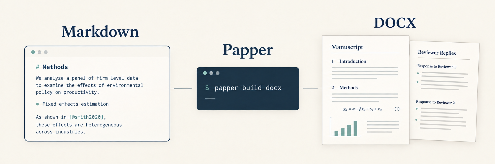
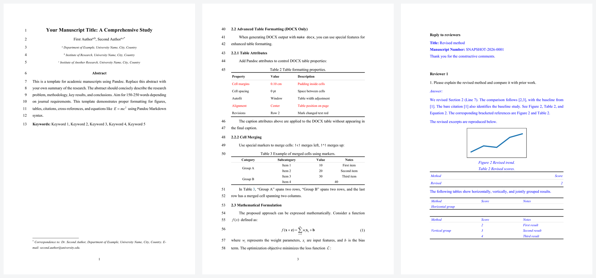

[English](README.md) | [简体中文](README.zh-CN.md)

# Papper

**用 Markdown 写论文，用 Word 交稿。**

Papper 将 Markdown 稿件构建为 Word 文档，处理参考文献、图表与公式编号，以及审稿回复。源文件方便 AI 修改、Git 审阅，需要交给合作者或期刊时，再生成 DOCX。

[让 AI 使用 Papper](#让-ai-使用-papper) · [VS Code 扩展](#vs-code-扩展) · [实际输出](#实际输出) · [文档导航](#文档导航)

## 让 AI 使用 Papper

先安装 [uv](https://docs.astral.sh/uv/getting-started/installation/)，再安装 Papper：

```bash
uv tool install papper
```

在 Codex、Claude Code、Workbuddy 等 AI Agent 中打开稿件所在文件夹，直接让它用 Papper 完成任务，例如：

- “请用 Papper 帮我把这个 DOCX 转成 Markdown。”
- “请将这个 MD 文件中的交叉引用、图片、表格、参考文献转换成 Papper 的格式。”
- “请帮我把这个 MD 用 Papper 转成 DOCX。”

新建论文时，`papper init` 还会生成 `AGENTS.md` 和 `CLAUDE.md`，供 Agent 读取项目指引。



*上图为 AI 生成的工作流示意图，真实 Word 输出见下方。*

## 快速开始

安装后，也可以自己运行命令，创建并构建第一篇论文：

```bash
papper init my-paper
cd my-paper
papper build docx
```

打开 **`output/docx/manuscript.docx`** 查看结果。之后编辑 `manuscript.md`，再次构建即可生成新的 Word 稿件。

需要中文主稿和审稿回复模板时，将初始化命令换成 `papper init my-paper --lang zh-cn`。运行 `papper doctor` 可以检查安装环境。

## VS Code 扩展

在 VS Code 中写作时，可以安装我们配套的 [Pandoc Manuscript Tools 扩展](https://marketplace.visualstudio.com/items?itemName=cesaryuan.pandoc-manuscript-tools)：

- **引用导航与补全**：跳转到标签、查找引用、输入 `@` 补全标签，并提示未定义引用和重复标签。
- **悬停预览**：编辑时直接查看公式及本地 SVG、EMF、WMF 图片。
- **更清楚的稿件显示**：高亮 Pandoc 块与 span、折叠修订属性，并用识别 Pandoc 语法的大纲浏览章节。
- **图片目录预览**：按网格、瀑布流或文件夹查看图片。
- **审稿回复导航**：在 `reply_to_reviewers.md` 中跳转到工作区根目录 `manuscript.md` 的标签。

## 实际输出

下面展示主稿和审稿回复示例经 Microsoft Word 渲染的真实页面。公式使用 `mathtype: true` 和 `mathtypeConversionMethod: mathtype` 构建，由已安装的 MathType 应用完成转换。

[](docs/assets/docx-examples.png)

可以查看[英文稿件源文件](template/manuscript.md)、[中文稿件源文件](template/manuscript-cn.md)和[审稿回复模板](template/reply_to_reviewers.md)，点击预览图可放大。这些示例展示支持的排版能力，具体期刊格式仍需按要求配置和检查。

也可以下载[主稿 DOCX](docs/assets/examples/manuscript.docx)和[审稿回复 DOCX](docs/assets/examples/reviewer-reply.docx)，在 Word 中检查排版和可编辑的 MathType 对象。

## 核心能力

Papper 基于 Pandoc 和 pandoc-crossref，将论文模板、Word 排版和审稿回复流程整合到一个命令行工具中。

| 你要完成的事 | Papper 提供的支持 |
| --- | --- |
| 起草和反复修改论文 | Markdown 源文件、可复用的项目结构，以及供 AI Agent 读取的写作指引 |
| 保持引用一致 | CSL 参考文献格式，以及图、表、公式和章节的交叉引用 |
| 准备 Word 主稿 | 作者信息、表格格式、公式编号、页面设置和 reference DOCX 样式 |
| 交付可编辑公式 | Word 原生公式或可编辑的 MathType 兼容对象 |
| 回复审稿意见 | 复用主稿编号的 DOCX、HTML 审稿回复，以及可选的行号定位 |
| 接入已有 Word 稿件 | DOCX 导入，恢复支持的公式、题注、图片和引用关系 |

内置中英文模板。中文构建提供本地化引用前缀、按章节编号的图表公式和 GB/T 7714 引文样式，显式指定的引文样式优先。也支持 HTML 预览和 JSON 导出。

## 日常写作与返修

初始化后，项目包含 `manuscript.md`、`style.yml`、`reply_to_reviewers.md`、示例图片与参考文献，以及 Agent 指引。稿件内容写在 Markdown 中，可复用的排版设置放在 `style.yml`。

```bash
papper build docx
papper build html
papper build docx reply_to_reviewers.md
```

审稿回复模板已在 YAML 头部声明 `reply: manuscript.md`。回复中使用主稿已有的图、表、公式和章节标签，可以保持引用编号一致。[查看审稿回复语法与行号定位 →](docs/manuscript-syntax.md#reviewer-replies)

需要为某个期刊选择样式文件或 Word reference 文档时：

```bash
papper build docx --style-file styles/journal.yml
papper build docx --reference-doc journal-reference.docx
```

这两个示例文件需要自行准备。CSL 控制参考文献格式，`style.yml` 和 reference DOCX 控制文档外观。适配期刊模板前，请先阅读[自定义 reference 与样式优先级](docs/style-configuration.md#one-off-docx-builds)。

已有 Word 初稿也可以导入到独立目录：

```bash
papper convert existing-paper.docx -o converted
```

命令生成 `converted/existing-paper.md` 及其图片资源。导入后请与原稿核对；复杂 Word 布局可能需要手工整理。[查看导入示例与恢复范围 →](docs/DOCX_IMPORT.md)

## 适合怎样的工作方式？

如果你希望保留 Markdown 稿件源文件，在修改时使用 AI 或 Git，并最终交付 Word，Papper 会比较适合。需要反复构建主稿和审稿回复时，它的价值尤其明显。

用于投稿前，请注意：

- **Markdown 是持续维护的源文件。** 在生成的 DOCX 中修改内容，不会自动合并回 Markdown；Word 导入是单独的操作。
- **投稿格式仍需检查。** 配置好引文样式和文档外观后，应按期刊要求核对最终 DOCX，Papper 不保证自动满足所有出版社模板。
- **回复中的行号定位可能依赖 Office 软件。** 从 Markdown 或 Word 生成行号来源时，Windows 需要 Microsoft Word，其他平台需要 LibreOffice；提供合适的 PDF 可省去这一步转换。
- **最终分页请在 Word 中检查。** HTML 预览方便检查内容，其分页和布局可能与 Word 不同。

## 文档导航

安装后的 CLI 内置写作与配置指南，你和 AI Agent 都可以直接在稿件项目中查询：

```bash
papper guide
papper guide syntax equations
papper guide style docx-text-styles
```

`papper guide` 列出章节与简短说明。指定章节或 `章节/小节` 可按需读取；在 `syntax` 或 `style` 后添加 `--full` 可查看全文。

| 想了解的内容 | 入口 |
| --- | --- |
| 稿件 YAML、引文、图表和公式语法 | [`papper guide syntax`](docs/manuscript-syntax.md) |
| 页面、字体、引文样式和 Word 设置 | [`papper guide style`](docs/style-configuration.md) |
| DOCX 导入与可选的引用恢复 | [导入指南](docs/DOCX_IMPORT.md) |
| 编辑器集成与本机 HTML API | [运行时与集成文档](docs/RUNTIME_AND_INTEGRATION.md) |
| 源码构建与验证 | [开发指南](DEVELOPMENT.md) |
| 打包与发布 | [维护者发布指南](docs/RELEASING.md) |
| 渲染实现 | [渲染内部说明](docs/MANUSCRIPT_RENDERING.md) |

## 更新与反馈

使用 `uv tool upgrade papper` 升级。运行 `papper --help` 或 `papper build --help` 查看命令与选项；需要诊断日志时添加 `--verbose`。

遇到问题时，请[提交 issue](https://github.com/cesaryuan/papper/issues)，附上 Papper 版本、操作系统、执行命令和最小复现示例。分享前请移除保密稿件内容。

Papper 自有代码采用 [MIT 许可证](LICENSE)，随包组件保留各自的许可证和声明。感谢 [Pandoc](https://pandoc.org/) 和 [pandoc-crossref](https://github.com/lierdakil/pandoc-crossref) 提供文档转换与交叉引用基础。
