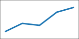

# 第一章

# 第二章

# 第三章

参见 @fig:architecture、@fig:next、@tbl:comparison 和 @tbl:next。

{#fig:architecture width=45% caption-en="Architecture diagram of the *MT-MoE ViT* network with $\\alpha$"}

{#fig:next width=45%}

| 模型 | 得分 |
| ---- | ---- |
| A | 95 |
| B | 96 |

: 模型性能对比 {#tbl:comparison caption-en="Performance comparison of **different models**" revision_rows="*" cell_margin="0.10cm"}

| 项目 | 值 |
| ---- | -- |
| A | 1 |

: 后续单语表 {#tbl:next}

参见 @fig:panels、@fig:panel-a、@fig:panel-b 和 @fig:panel-c。

:::: {#fig:panels caption-en="Comparison of **models** with $\\alpha$"}

{#fig:panel-a width=49% caption-en="Baseline *model*"}
{#fig:panel-b width=49% caption-en="Proposed model with $\\beta$"}

{#fig:panel-c width=49% caption-en="Panel on a separate row"}

{#fig:panel-d width=49% caption-en=""}

模型比较。

::::

{#fig:child-only-a width=49% caption-en="Translated panel only"}
{#fig:child-only-b width=49%}

只有子图提供英文题注。

# 第四章

{#fig:chapter width=45% caption-en="Figure in a new chapter"}

{#fig:parent-only-a width=49%}

只有总题注提供英文译文。

后向引用：@fig:panels、@fig:panel-a、@fig:panel-b、@fig:panel-c 和 @fig:next。

图目录只包含主题注：

\listoffigures

表目录只包含主题注：

\listoftables
