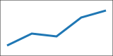

[]{t="toc" title="Research contents" depth="2"}

[]{t="listofFigures" title="Main figures"}

[]{t="listofFigures" title="Figures and panels" includeSubfigures="true"}

[]{t="listofTables" title="Data tables"}

Date: **[]{t="date"}**. Page: *[]{t="pageNum" format="lowerRoman"}*.

[]{t="sectionBreak" pageStart="1" header="**Methods header**" footer='Section page []{t="pageNum"}' headerAlignment="left" footerAlignment="right"}

# Methods {#sec:methods}

{#fig:primary width=30% caption-en="Translated primary figure"}

:::: {#fig:panels}

{#fig:first width=30%}

{#fig:second width=30%}

Combined panels

::::

| Sample | Value |
| ------ | ----: |
| A      | 3     |

: Measurements {#tbl:measurements caption-en="Translated measurements"}

## Details {#sec:details}

Before the page break. []{t="pageBreak"} After the page break.

[]{t="sectionBreak" kind="continuous" headerLink="false" footerLink="true"}

# Results {#sec:results}

Independent copy of the previous header; inherited footer and continued page numbering.

[]{t="sectionBreak" kind="oddPage" header="" footer=""}

Final section with cleared page stories.

# Caption sources

[]{t="listofFigures" title="Main captions"}

[]{t="listofFigures" title="Explicit main captions" caption-en="false"}

[]{t="listofFigures" title="English captions" caption-en="true"}

[]{t="listofFigures" title="Main captions and panels" includeSubfigures="true"}

[]{t="listofFigures" title="Explicit main captions and panels" includeSubfigures="true" caption-en="false"}

[]{t="listofFigures" title="English captions and panels" includeSubfigures="true" caption-en="true"}

[]{t="listofTables" title="Main table captions"}

[]{t="listofTables" title="Explicit main table captions" caption-en="false"}

[]{t="listofTables" title="English table captions" caption-en="true"}

{#fig:bilingual width=25% caption-en="English **translation** with $\\alpha$（译注）"}

{#fig:english width=25%}

{#fig:chinese width=25%}

:::: {#fig:source-panels}

{#fig:panel-cn width=25%}

{#fig:panel-en width=25%}

中文组合图

::::

| Item | Value |
| ---- | ----- |
| A    | 1     |

: 中文双语表 {#tbl:bilingual caption-en="English table translation"}

| Item | Value |
| ---- | ----- |
| B    | 2     |

: English only table {#tbl:english}

| Item | Value |
| ---- | ----- |
| C    | 3     |

: 中文单语表 {#tbl:chinese}
