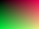

# Editable rectangular crops

An inline detail {width="0.5in" crop-left="25" crop-right="25"} keeps the original embedded.

{#fig:detail width="2in" crop-top="20" crop-bottom="10"}

:::: {#fig:panels}
{#fig:left width="50%" crop-right="50"}
{#fig:right width="50%" crop-left="50"}

Independent crops of a shared image.
::::

The note also keeps editable cropping.[^detail]

[^detail]: {width="1in" crop-left="12.5" crop-top="10"}
